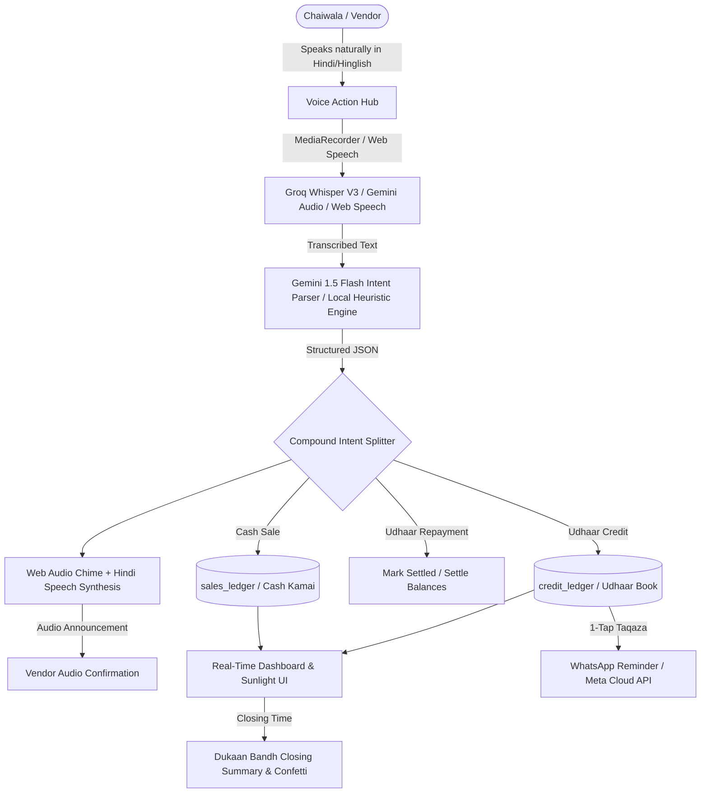

# 🎙️ BahiKhaata Voice (बहीखाता आवाज़)
> **हाथ खाली, हिसाब पक्का — Hands-Free, Voice-First Ledger for India's Micro-Economy**

BahiKhaata Voice is a Progressive Web Application (PWA) purpose-built for India's unorganized micro-retailers (chaiwalas, kirana stores, pan shops, street food vendors, and local tradespeople). It eliminates paper clutter, dirty notebook thumbing, and manual keypad typing by converting continuous natural speech into structured financial records with instant soundbox audio confirmations.

---

## 🌟 Key Capabilities

1. **Zero-Typing / Voice-Only Action Hub**
   - Single-tap or hold-to-talk permanent microphone button.
   - Dynamic audio frequency visualizer powered by the Web Audio API.
   - Handles noisy operational environments, street sounds, and Indian accents.

2. **Intelligent Multi-Intent Parsing (Hindi / Hinglish / Regional)**
   - Accurately splits compound spoken sentences into distinct financial categories.
   - *Example:* Spoken sentence:  
     `"2 chai bechi 20 rupaye ki, aur 4th street wale Ramesh ka 40 rupaye udhaar likh lo"`  
     *Result:*
     - **Cash Sale:** ₹20 (Quantity: 2 cups, Category: Chai)
     - **Udhaar (Credit):** ₹40 (Customer: Ramesh, Location tag: "4th street wale", Status: Pending)

3. **Merchant Soundbox Audio Feedback (Paytm / PhonePe Style)**
   - Plays a pleasant dual-tone alert chime followed by clear speech in Hindi:  
     `"₹20 नकद प्राप्त हुए। Ramesh का ₹40 उधार दर्ज हुआ।"`
   - Instantly reassures vendors with busy hands without needing them to look at the screen.

4. **High-Contrast Sunlight Mode (धूप मोड)**
   - Specially tuned for outdoor street vendors operating under direct Indian sunlight.
   - Deep OLED black background with fluorescent emerald (`#10B981`) and bright amber (`#F59E0B`) touch targets.

5. **WhatsApp Credit Collection Reminders (तकाज़ा)**
   - One-tap reminder button that formats a polite Hindi payment request:
     `"नमस्ते रमेश जी, आपकी बहीखाता दुकान पर ₹40 की उधारी बाकी है। कृपया भुगतान कर दें।"`
   - Opens WhatsApp Click-to-Chat directly or calls Meta Cloud API.

6. **End-of-Day Closing Summary (दुकान बंद • हिसाब मिलान)**
   - Calculates total cash collected, new credit given, credit recovered, and net cash in drawer (*Galla*).
   - Generates a closing voice digest, confetti celebration, and 1-tap WhatsApp sharing of the daily financial report.

7. **Zero-Config Offline Resilience + Supabase Cloud Realtime**
   - Works immediately out of the box using built-in deterministic Hindi/Hinglish NLP heuristics and browser storage.
   - Seamlessly upgrades to Google Gemini 1.5/2.0 Flash + Groq Whisper Large V3 + Supabase PostgreSQL real-time tables when API keys are configured.

---

## 🛠️ Architecture & Flow



---

## 🚀 Quick Start Guide

### 1. Install & Run Locally
```bash
# Clone and enter the directory
cd e:\awaz

# Install dependencies
npm install

# Build production bundle
npm run build

# Start production server
npm run start
```
The app will be running at **http://localhost:3000**.

### 2. Configure Environment Variables (Optional)
Copy `.env.example` to `.env.local` or enter keys via the **Settings (⚙️)** modal directly in the app:

```env
# Google Gemini API (For structured intent extraction)
GEMINI_API_KEY=your_gemini_api_key_here

# Groq Cloud API (For Whisper Large V3 Indian Accent STT)
GROQ_API_KEY=your_groq_api_key_here

# Supabase (For cloud real-time PostgreSQL sync)
NEXT_PUBLIC_SUPABASE_URL=https://your-project.supabase.co
NEXT_PUBLIC_SUPABASE_ANON_KEY=your_supabase_anon_key_here

# Meta Cloud API (For WhatsApp Business automation)
META_WHATSAPP_TOKEN=your_token
META_PHONE_NUMBER_ID=your_id
```

### 3. Supabase Database Setup
If using Supabase, copy and paste the contents of `supabase/schema.sql` into your [Supabase SQL Editor](https://supabase.com/dashboard/project/_/sql). It sets up:
- `sales_ledger` table with categories & payment modes
- `credit_ledger` table with customer tags, status & settlement dates
- `daily_closing` table for historical archives
- Row Level Security (RLS) & Realtime Publication

---

## 📱 Tech Stack

- **Framework**: Next.js 16 (App Router, Turbopack, React 19)
- **Styling**: Tailwind CSS v4, High-Contrast Sunlight Mode, Mobile PWA Layout
- **Audio & Speech**: HTML5 MediaRecorder, Web Audio API (Synthesized Chimes), Web Speech Synthesis (`hi-IN`)
- **Speech-to-Text (STT)**: Groq Whisper Large V3 + Web Speech API
- **AI Intent Parsing**: Google Gemini 1.5 Flash + Local Rule-Based NLP Parser Fallback
- **Database**: Supabase (PostgreSQL Realtime) + Offline LocalStorage
- **Messaging**: WhatsApp Click-to-Chat Deep Linking + Meta Cloud API
- **Icons & Delight**: Lucide React + Canvas Confetti
